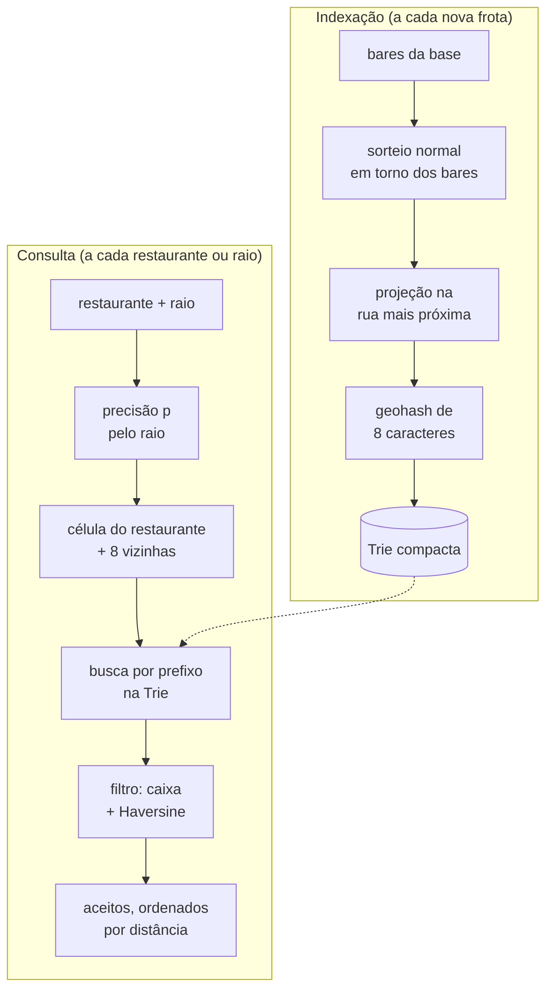
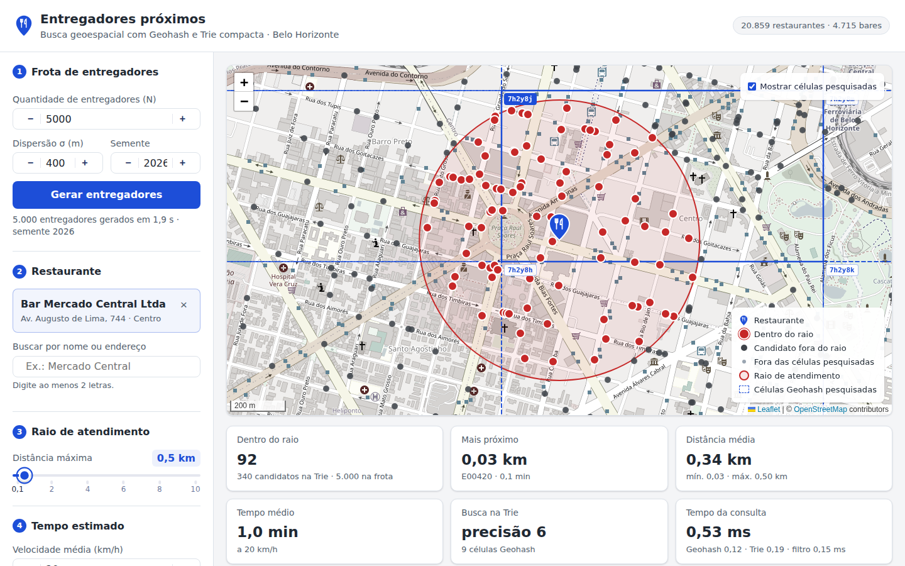
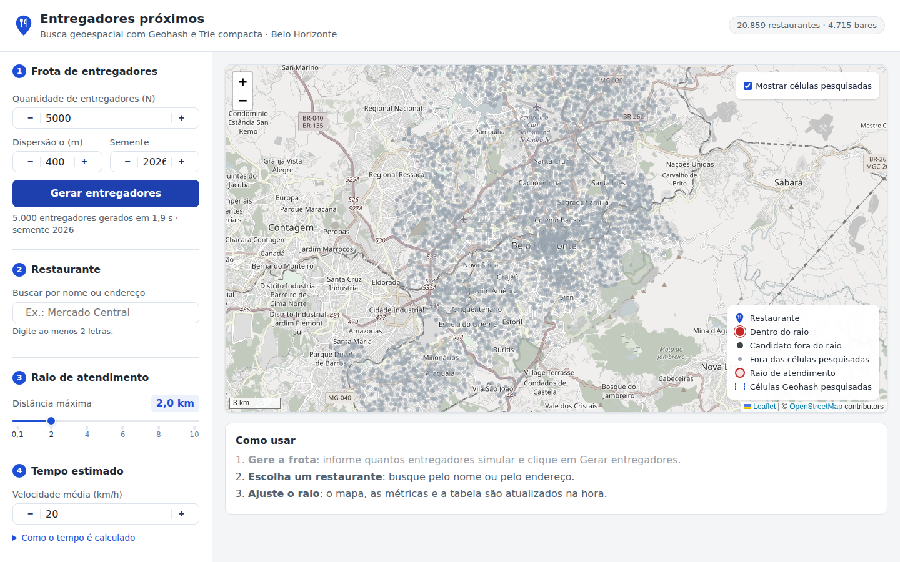
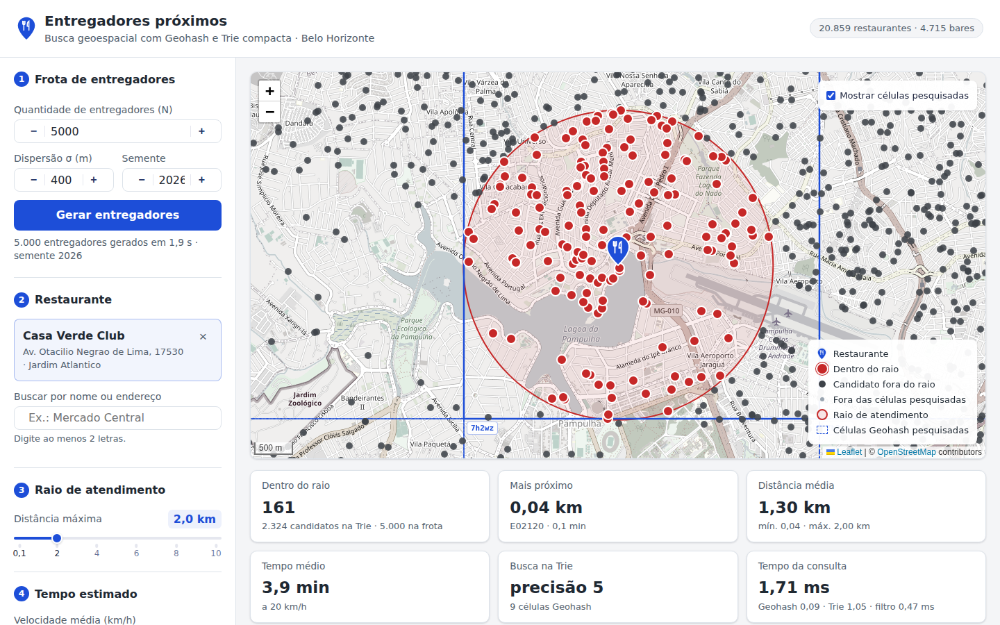
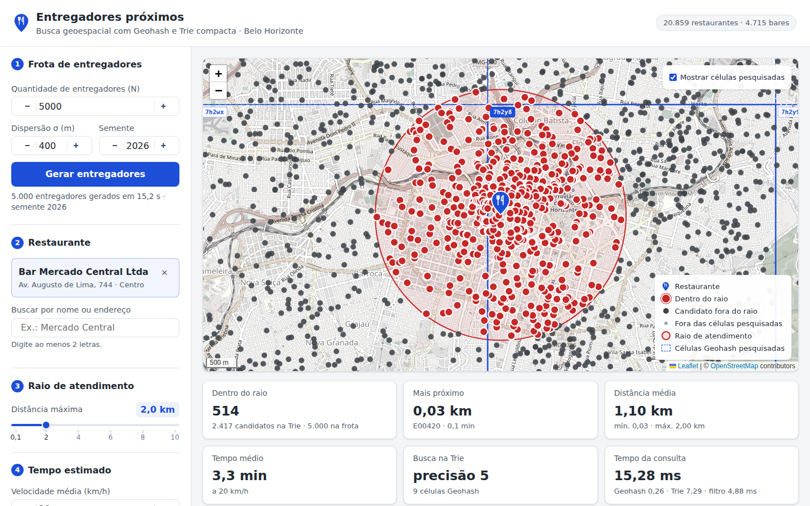
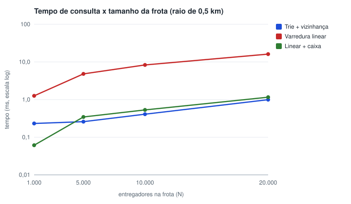
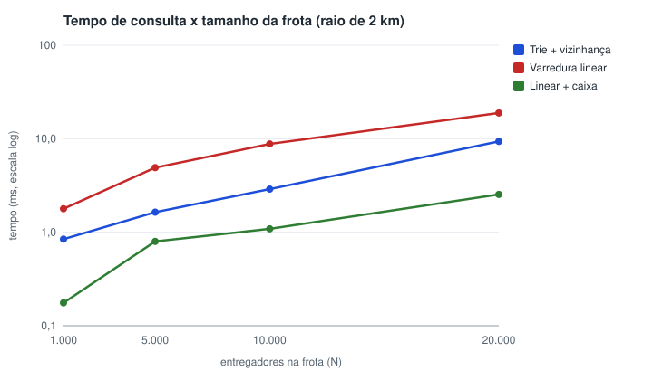
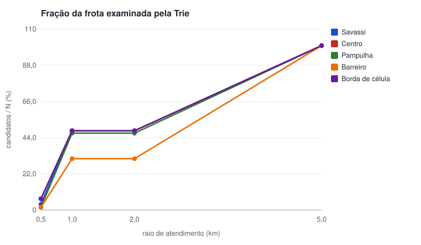
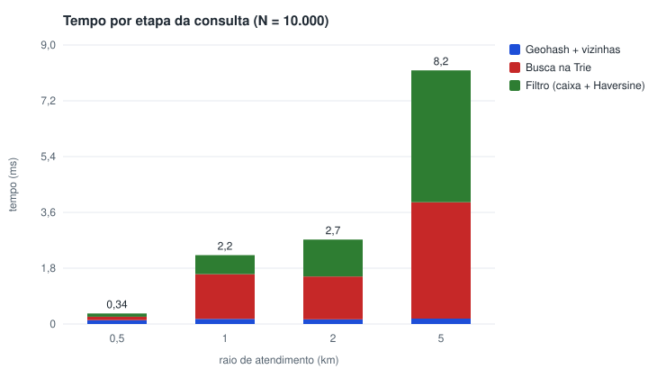

# Relatório: Indexação Geoespacial com Geohash e Trie Compacta

**Trabalho Prático 1, DCC207 Algoritmos 2 (UFMG)**

**Aluna:** Luana Ribeiro Palhares 

## 1. Introdução

Aplicativos de entrega precisam identificar rapidamente os entregadores próximos a um restaurante.
Comparar a posição do restaurante com a de todos os entregadores resolve o problema, mas o custo
cresce linearmente com o tamanho da frota. Este trabalho implementa, para Belo Horizonte, um
motor de busca que resolve esse problema geométrico com uma estrutura de strings.

1. Cada posição é convertida em um **Geohash**, uma string em que prefixos comuns indicam
   proximidade espacial.
2. Os geohashes são armazenados em uma **Trie compacta**, cuja busca por prefixo devolve os
   entregadores de uma região em O(m + k).
3. Como pontos próximos podem cair em células com prefixos diferentes, a busca também cobre as
   **8 células vizinhas**.
4. Um **filtro geométrico** final (Haversine) mantém apenas os entregadores dentro do raio de
   atendimento.

A frota é sintética. As posições seguem uma distribuição normal em torno dos bares da cidade e são
projetadas sobre a malha viária do OpenStreetMap. Os resultados são exibidos em uma página
interativa com mapa, tabela e métricas.

## 2. Visão geral

O sistema tem dois fluxos. A **indexação** roda a cada nova frota; a **consulta**, a cada
restaurante ou raio escolhido.



O código é dividido em camadas, e as dependências sempre apontam para o núcleo:

| Pacote | Conteúdo | Dependências |
|---|---|---|
| `core/` | Geohash, Trie, geometria, índice da frota | biblioteca padrão |
| `catalog/` | base de restaurantes e busca textual | biblioteca padrão |
| `simulation/` | geração da frota e projeção viária | `core`, `osmnx` |
| `app/` | interface | `dash`, `dash-leaflet` |
| `scripts/` | pré-processamento, benchmark e gráficos | biblioteca padrão |

As estruturas e os algoritmos centrais não usam bibliotecas externas. As únicas dependências
diretas do projeto são `dash`, `dash-leaflet` e `osmnx`.

## 3. Base de dados

A base de bares disponível continha nome e endereço dos estabelecimentos, mas não as coordenadas.
Ela corresponde exatamente ao recorte dos CNAEs de alimentação (5611201, 5611203, 5611204 e
5611205) do cadastro de Atividades Econômicas da Prefeitura de Belo Horizonte de setembro de 2026:
as mesmas 20.859 linhas, na mesma ordem. Esse arquivo público contém a coluna `GEOMETRIA`, e por
isso foi adotado como fonte.

As coordenadas da PBH estão em SIRGAS 2000 / UTM zona 23 Sul. O script
`scripts/build_restaurants.py` filtra os quatro CNAEs e converte as coordenadas para latitude e
longitude com a série inversa de Krüger para a projeção transversa de Mercator (Karney, 2011). A
conversão foi validada contra a biblioteca `pyproj` em todos os pontos, com diferença máxima
inferior a 1 µm. O `pyproj` não é dependência do projeto. O arquivo resultante,
`data/restaurants.csv` (2,9 MB), é o único lido pelo sistema.

| Categoria | CNAE | Estabelecimentos |
|---|---|---|
| Restaurantes | 5611201 | 8.465 |
| Lanchonetes | 5611203 | 7.679 |
| Bares sem entretenimento | 5611204 | 3.252 |
| Bares com entretenimento | 5611205 | 1.463 |

Os 20.859 estabelecimentos podem ser buscados na interface. Os 4.715 bares são os centros da
distribuição dos entregadores.

## 4. Geohash

### 4.1 Codificação

O Geohash divide o espaço ao meio sucessivamente, alternando entre longitude e latitude. Os
intervalos iniciais são [−180, 180] para a longitude e [−90, 90] para a latitude. A cada passo, o
intervalo do eixo corrente é dividido ao meio, e o bit indica a metade que contém o ponto: 1 para
a superior (leste ou norte) e 0 para a inferior. Cada grupo de 5 bits gera um caractere do alfabeto
Base32 `0123456789bcdefghjkmnpqrstuvwxyz`.

Exemplo com os dois primeiros caracteres do Mercado Central (−19,923; −43,943):

| bit | eixo | intervalo | meio | bit |
|---|---|---|---|---|
| 0 | lon | [−180, 180] | 0 | 0 |
| 1 | lat | [−90, 90] | 0 | 0 |
| 2 | lon | [−180, 0] | −90 | 1 |
| 3 | lat | [−90, 0] | −45 | 1 |
| 4 | lon | [−90, 0] | −45 | 1 |
| 5 | lat | [−45, 0] | −22,5 | 1 |
| 6–9 | … | … | … | 0 0 0 0 |

Os grupos `00111` e `10000` valem 7 e 16, que correspondem aos caracteres `7` e `h`. Com 8
caracteres, o código completo é `7h2y8j17`. Cada caractere adicional apenas refina a célula
anterior, de modo que todos os pontos com prefixo `7h2y8` pertencem à mesma célula, de cerca de
4,6 × 4,9 km.

Os entregadores são armazenados com **precisão 8**, o limite definido no enunciado, o que
corresponde a células de cerca de 36 × 19 m em BH. A decodificação (`decode_bbox`) repete as mesmas
bissecções, lendo os bits em vez de gerá-los. Os limites obtidos são frações com potência de 2 no
denominador, representadas sem erro em ponto flutuante.

### 4.2 Células vizinhas

As 8 vizinhas de uma célula são obtidas a partir do seu centro: desloca-se exatamente uma célula
em cada direção (±altura, ±largura) e o ponto resultante é recodificado. O ponto deslocado cai no
centro da vizinha, nunca sobre uma fronteira, o que elimina ambiguidades. O próprio `encode` trata
os casos em que a vizinha pertence a outra célula-pai: a vizinha leste de `7h2xz`, por exemplo, é
`7h2zb`. A longitude dá a volta no antimeridiano e a latitude satura nos polos. Cada vizinha custa
uma codificação, O(p).

A codificação foi comparada com a biblioteca `pygeohash` em 100 mil pontos, sem divergências. Os
vizinhos foram verificados geometricamente em mais de 10 mil células, incluindo todas as filhas
de pais aleatórios: cada vizinha tem o mesmo tamanho da célula original e está encostada no lado
correto.

## 5. Trie compacta

### 5.1 Estrutura dos nós

```python
class _Node:
    __slots__ = ("label", "children", "bucket")
    label: str                    # rótulo da aresta que chega ao nó
    children: dict[str, _Node]    # chave = primeiro caractere do rótulo do filho (≤ 32)
    bucket: list | None           # entregadores cuja chave termina no nó
```

- **Rótulos nas arestas (compressão de caminho).** Cadeias de nós com um único filho são reduzidas
  a uma aresta. Com 10 mil entregadores, a árvore tem 12.591 nós, contra 16.963 em uma Trie comum
  (26% a menos). A redução se concentra nos níveis mais profundos, onde os ramos raramente se
  dividem. A compressão também garante a coleta em O(k) (seção 5.3).
- **Filhos em dicionário indexado pelo primeiro caractere.** Os rótulos dos filhos de um nó começam
  com caracteres distintos, então a escolha da aresta é O(1).
- **Bucket em lista.** Vários entregadores podem compartilhar o mesmo geohash de 8 caracteres. Com
  20 mil entregadores, o maior bucket contém 4.
- **O bucket armazena o próprio objeto do entregador**, e não o identificador, o que evita uma
  consulta adicional por candidato.
- **`__slots__`** reduz a memória ocupada por nó.

**Invariante:** todo nó, exceto a raiz, tem bucket não vazio ou pelo menos dois filhos.

### 5.2 Operações

- **`insert(chave, valor)`, em O(|chave|).** A descida compara a chave com os rótulos. Quando a
  chave diverge no meio de uma aresta, a aresta é dividida: um nó intermediário recebe o prefixo
  comum e passa a ter como filhos o nó antigo e o novo ramo.
- **`remove(chave, valor)`, em O(|chave| + b).** O valor é retirado do bucket. Um nó sem bucket e
  sem filhos é removido. Um nó sem bucket e com um único filho é fundido a esse filho, o que
  restaura a invariante.
- **`search_prefix(prefixo)`, em O(m + k).** A descida consome o prefixo. Se ele termina no meio de
  uma aresta, a busca continua no nó de destino, desde que o rótulo comece com o restante do
  prefixo. Em seguida, os buckets da subárvore são coletados por uma busca em profundidade
  iterativa, com pilha explícita.

### 5.3 Complexidade da busca por prefixo

Sejam m o tamanho do prefixo e k o número de valores devolvidos.

- **Descida:** cada caractere do prefixo é comparado no máximo uma vez, e a escolha do filho é
  O(1). O custo é O(m).
- **Coleta:** sejam T a subárvore e L o número de nós terminais de T. Cada terminal contém pelo
  menos um valor, logo L ≤ k. Pela invariante, toda folha de T é terminal, e todo nó interno não
  terminal tem pelo menos dois filhos. Em uma árvore em que todo nó interno tem pelo menos dois
  filhos, há menos nós internos do que folhas. Portanto |T| ≤ 2L − 1 ≤ 2k − 1, e a coleta custa
  O(|T| + k) = O(k).

A busca custa O(m + k), como exigido. Sem a compressão, uma subárvore com poucos valores poderia
conter longas cadeias de nós com um único filho, e a coleta deixaria de ser O(k).

A consulta faz a busca nas 9 células. Células de mesma precisão são disjuntas, então nenhum
entregador é devolvido duas vezes, e o custo total é O(9m + K) = O(m + K), em que K é o número
total de candidatos.

## 6. Consulta: vizinhança e filtragem

### 6.1 Escolha da precisão

A precisão do prefixo depende do raio. O sistema adota a **maior precisão p em que a célula tem
altura e largura de pelo menos r**. Com isso, o círculo de atendimento sempre cabe no bloco 3×3
formado pela célula do restaurante e suas vizinhas.

- **Altura:** a distância mínima entre pontos separados por Δφ em latitude é R·Δφ. Se r ≤ R·Δφ,
  nenhum ponto do círculo sai das três linhas do bloco.
- **Largura:** a menor distância de um ponto na latitude φ até um meridiano afastado Δλ é
  R·asin(cos φ·sin Δλ). Esse valor diminui à medida que |φ| cresce, por isso é calculado na borda
  da célula mais distante do equador, que é o pior caso.

Valores para BH:

| Raio | Precisão | Célula (largura × altura) |
|---|---|---|
| ≤ 0,14 km | 7 | 144 m × 153 m |
| ≤ 0,61 km | 6 | 1,15 km × 0,61 km |
| ≤ 4,59 km | 5 | 4,59 km × 4,89 km |
| ≤ 19,5 km | 4 | 36,7 km × 19,5 km |

Um teste automatizado sorteia 2.000 restaurantes e raios e verifica que pontos dentro do raio,
inclusive sobre a circunferência, sempre caem em uma das 9 células.

### 6.2 Problema de borda

Pontos muito próximos podem ter prefixos diferentes quando estão em lados opostos de uma divisão.
A lanchonete DJ Lanches (R. Rio Grande do Sul, 315, Centro) está a **1 m** da borda oeste da
célula `7h2y8`. Sem a busca nas vizinhas, um entregador do outro lado da rua, na célula `7h2wx`,
não seria encontrado.

O efeito é mais visível com raio de 0,5 km (precisão 6), na Figura 1: o Mercado Central fica
próximo da divisa entre `7h2y8j`, `7h2y8h` e `7h2y8k`, e há entregadores aceitos nas três células.


*Figura 1: Mercado Central, raio de 0,5 km. A célula central tem contorno contínuo e as vizinhas,
tracejado. Os pinos vermelhos fora da célula central só são encontrados graças à busca nas
vizinhas.*

### 6.3 Filtragem e tempo estimado

Os candidatos devolvidos pela Trie passam por dois filtros:

1. **Caixa do círculo.** A menor caixa que contém o círculo na esfera tem Δφ = r/R e
   Δλ = asin(sin(r/R)/cos φ). O teste custa duas comparações por candidato e descarta a maior parte
   dos rejeitados.
2. **Haversine,** aplicado apenas aos candidatos dentro da caixa:
   `d = 2R·asin(√(sin²(Δφ/2) + cos φ₁·cos φ₂·sin²(Δλ/2)))`, com R = 6.371,0088 km.

Os entregadores com d ≤ r são os **aceitos**, ordenados por distância. O tempo estimado de chegada
é d ÷ velocidade média (20 km/h por padrão, ajustável). A estimativa é otimista, pois usa a
distância em linha reta.

Cada etapa é cronometrada com `time.perf_counter`: codificação (precisão, geohash e vizinhas),
busca na Trie e filtro. Os tempos são exibidos na interface.

## 7. Geração dos dados sintéticos

### 7.1 Distribuição baseada em demanda

- **Centros:** os 4.715 bares da base.
- **Distribuição equitativa:** cada centro recebe ⌊N/C⌋ entregadores, e os N mod C restantes são
  atribuídos a centros sorteados sem reposição. Quando N < C, são sorteados N centros, cada um com
  um entregador. Nos dois casos, as quantidades por centro diferem em no máximo 1.
- **Posição inicial:** dois deslocamentos independentes `random.gauss(0, σ)`, em metros, nas
  direções norte e leste, convertidos para graus por `Δφ = dy/M` e `Δλ = dx/(M·cos φ)`, com
  M = 111.195 m por grau. O valor padrão é σ = 400 m.
- **Reprodutibilidade:** um único gerador `random.Random(semente)` realiza todos os sorteios, então
  a mesma semente sempre produz a mesma frota. Sem semente informada, o sistema sorteia uma e a
  exibe na interface.

O resultado concentra entregadores próximos aos bares, com densidade decrescente em função da
distância (Figura 2).


*Figura 2: 5.000 entregadores (semente 2026). A concentração acompanha as regiões com mais bares.*

### 7.2 Correção da posição (restrição viária)

A distribuição normal posiciona pontos em quarteirões, edifícios e até na Lagoa da Pampulha. A
correção é feita em três passos:

1. O grafo viário de BH é obtido uma única vez pelo `osmnx` (`network_type="drive"`, com 32.290 nós
   e 82.931 arestas) e armazenado em cache no formato GraphML.
2. Uma única chamada em lote a `osmnx.distance.nearest_edges` identifica a rua mais próxima de cada
   ponto.
3. O ponto é projetado ortogonalmente sobre a polilinha dessa rua, em um plano local: o parâmetro t
   de cada segmento é limitado a [0, 1], e o segmento mais próximo é escolhido. A projeção é
   implementação própria e posiciona o entregador ao longo da via, e não apenas nos cruzamentos,
   como ocorreria com o uso do nó mais próximo.

Em um teste com 500 pontos, todos ficaram a menos de 1 m de uma rua. A geração de 5.000
entregadores leva cerca de 2 s. Na Figura 3, nenhum entregador aparece sobre a Lagoa da Pampulha.


*Figura 3: consulta na Pampulha (raio de 2 km). Os entregadores contornam a lagoa, sobre as vias.*

Limitação: com o grafo em graus, o `nearest_edges` mede distâncias sem o fator cos φ ≈ 0,94. Em
casos raros, a rua escolhida pode não ser a mais próxima em metros. O entregador permanece sobre
uma rua, pois a projeção final é feita na própria aresta.

### 7.3 Nova frota

Ao acionar "Gerar entregadores", o sistema cria um índice novo (Trie e dicionário) e descarta o
anterior por inteiro. O mapa recebe a nova frota em uma única atualização. A reconstrução da Trie
custa O(8N), o que é mais simples e mais rápido do que N remoções.

## 8. Interface

A página foi construída com Dash e dash-leaflet. O painel segue a ordem de uso: (1) geração da
frota, (2) escolha do restaurante, (3) ajuste do raio e (4) velocidade média para o tempo estimado.

- **Mapa:** duas camadas em canvas. A frota inteira é enviada uma vez por geração, em cinza-claro.
  Os candidatos são enviados a cada consulta e desenhados por cima: aceitos em vermelho com borda
  branca e rejeitados em cinza-escuro. Isso mantém o mapa fluido com 20 mil pontos.
- **Elementos do mapa:** ícone próprio para o restaurante, círculo do raio de atendimento e as 9
  células pesquisadas, que podem ser exibidas com o rótulo do prefixo.
- **Busca de restaurante:** por nome ou endereço, sem distinção de acentos e maiúsculas.
- **Métricas:** entregadores dentro do raio, candidatos, entregador mais próximo, distâncias média,
  mínima e máxima, tempo médio e tempo da consulta por etapa.
- **Tabela:** todos os entregadores aceitos, com distância, tempo estimado e geohash.
- **Validação:** valores fora da faixa exibem uma mensagem e desabilitam o botão de geração.


*Figura 4: consulta no Mercado Central com raio de 2 km: mapa, métricas e início da tabela.*

## 9. Testes

O projeto tem 89 testes automatizados (pytest), todos aprovados.

| Área | Verificações |
|---|---|
| Geohash | vetores conhecidos (`ezs42`, `u4pruydqqvj`), ida e volta em 10 mil pontos, vizinhos geometricamente corretos em mais de 10 mil células, antimeridiano e polos |
| Trie | 10 mil inserções e remoções aleatórias com verificação da invariante; todos os prefixos comparados com varredura linear; prefixo no meio de aresta; buckets com repetição |
| Geometria | Haversine, tabela de precisões, cobertura do bloco 3×3, projeção em segmentos |
| Consulta | 200 consultas aleatórias com resultado **idêntico** ao da força bruta, incluindo casos com aceitos fora da célula central |
| Simulação | mesma semente gera a mesma frota; distribuição equitativa; desvio-padrão empírico próximo de σ; pontos projetados a menos de 1 m de uma rua |
| Interface | nova frota substitui a anterior por completo; a tabela lista todos os aceitos |

## 10. Experimentos

Ambiente: Python 3.12.3, Linux (WSL2), x86_64.

### 10.1 Consultas na interface

Configuração: frota de 5.000 entregadores (semente 2026, σ = 400 m, com projeção viária) e
velocidade de 20 km/h. Os tempos são os exibidos na interface em cada consulta. As consultas 2, 3
e 6 aparecem nas Figuras 4, 3 e 1; a consulta 5 é o caso de borda da seção 6.2.

| # | Restaurante | Raio | p | Candidatos | Aceitos | Mais próximo | Tempo (ms) |
|---|---|---|---|---|---|---|---|
| 1 | Dona Deja (Savassi) | 2 km | 5 | 2.417 | 359 | 0,08 km | 2,78 |
| 2 | Bar Mercado Central (Centro) | 2 km | 5 | 2.417 | 514 | 0,03 km | 2,31 |
| 3 | Casa Verde Club (Pampulha) | 2 km | 5 | 2.324 | 161 | 0,04 km | 1,71 |
| 4 | Tatu Rei do Angu (Barreiro) | 2 km | 5 | 1.551 | 138 | 0,07 km | 1,16 |
| 5 | DJ Lanches (Centro, borda de célula) | 2 km | 5 | 2.417 | 507 | 0,04 km | 2,01 |
| 6 | Bar Mercado Central (Centro) | 0,5 km | 6 | 340 | 92 | 0,03 km | 0,53 |
| 7 | Bar Mercado Central (Centro) | 5 km | 4 | 5.000 | 1.729 | 0,03 km | 83,40* |

\* A soma das etapas dessa consulta foi de 3,6 ms; o restante corresponde a uma pausa do coletor de
lixo do Python durante a montagem do resultado. No benchmark, que desativa o coletor durante as
medições, a mediana da mesma configuração é 6,7 ms.

### 10.2 Desempenho

O script `scripts/benchmark.py` compara três formas de responder à mesma consulta:

- **Trie + vizinhança:** método deste trabalho.
- **Varredura linear:** Haversine em todos os entregadores.
- **Linear + caixa:** varredura linear com o mesmo pré-filtro de caixa da busca indexada.

Foram usadas frotas de 1.000 a 20.000 entregadores (sem projeção viária, que não altera o custo
da busca), raios de 0,5 a 5 km e os 5 restaurantes da seção anterior. Cada valor é a mediana de
30 execuções, após 3 de aquecimento e com o coletor de lixo desativado. A tabela apresenta a média
entre os restaurantes.

| N | Raio | p | Candidatos / N | Trie (ms) | Linear (ms) | Linear + caixa (ms) |
|---|---|---|---|---|---|---|
| 10.000 | 0,5 km | 6 | 4,1% | **0,41** | 8,31 | 0,53 |
| 10.000 | 1 km | 5 | 44,5% | 1,96 | 8,28 | **0,75** |
| 10.000 | 2 km | 5 | 44,5% | 2,89 | 8,80 | **1,09** |
| 10.000 | 5 km | 4 | 100% | 10,17 | 7,95 | **3,58** |
| 20.000 | 0,5 km | 6 | 4,1% | **0,99** | 16,12 | 1,16 |
| 20.000 | 2 km | 5 | 44,4% | 9,35 | 18,85 | **2,53** |

<p align="center">
  
  
</p>

*Figura 5: tempo de consulta em função de N, com raio de 0,5 km (esquerda) e 2 km (direita),
em escala logarítmica.*

A construção do índice leva de 11 ms (N = 1.000) a 160 ms (N = 20.000). Com 20 mil entregadores,
a Trie tem 25.113 nós, altura 6 e rótulo médio de 1,2 caractere.

### 10.3 Discussão

**Em relação à varredura linear simples,** a busca indexada é de 2× a 20× mais rápida para raios de
até 2 km, e o ganho cresce com N. Com raio de 0,5 km, a Trie examina cerca de 4% da frota.

**Em relação à varredura linear com pré-filtro de caixa,** o resultado se inverte para raios a
partir de 1 km. A causa é a **granularidade fixa do Geohash**:

- Quando o raio ultrapassa cerca de 0,61 km, a precisão cai de 6 para 5, e a área pesquisada
  cresce cerca de 30 vezes. Com p = 5, o bloco 3×3 cobre aproximadamente 14 × 15 km, quase metade
  da frota (Figura 6).
- Com esse volume de candidatos, a coleta na Trie (percurso de nós em Python) custa mais por
  entregador do que duas comparações de ponto flutuante. A Figura 7 mostra que a etapa da Trie
  passa a dominar a partir de 1 km.
- Com p = 4 (raio de 5 km), o bloco cobre a cidade inteira, e o índice não descarta nenhum
  entregador.

<p align="center">
  
  
</p>

*Figura 6 (esquerda): fração da frota examinada pela Trie, por raio e por restaurante. Figura 7
(direita): tempo por etapa da consulta indexada, N = 10.000.*

A Trie é vantajosa quando a célula é pequena em relação à frota, ou seja, com raios pequenos e
frotas grandes, que é o cenário típico de um aplicativo de entregas. Para raios maiores, uma
melhoria natural é cobrir o círculo com mais células de precisão maior (por exemplo, todas as
células de precisão p+1 que intersectam a caixa do círculo), em vez de apenas as 8 vizinhas na
precisão p.

Todas as consultas do benchmark ficaram abaixo de 30 ms, mesmo com 20 mil entregadores, e a
interface responde sem atraso perceptível.

## 11. Limitações

- **Distância em linha reta:** o tempo estimado usa Haversine, não o trajeto pelas ruas, e é
  portanto otimista.
- **Granularidade fixa:** a eficiência da busca depende de o raio estar logo abaixo de um limiar
  de precisão (seção 10.3).
- **Rua mais próxima medida em graus:** a escolha da aresta pelo `osmnx` não aplica o fator cos φ
  (seção 7.2).
- **Frota estática:** os entregadores não se movem. Cada geração produz uma frota nova.
- **Usuário único:** a frota fica na memória do servidor e é compartilhada entre abas.

## 12. Reprodução

As instruções completas estão no README.

```bash
pip install -r requirements.txt
python -m app.main                  # interface em http://127.0.0.1:8050
pytest                              # testes
python -m scripts.benchmark         # experimentos (gera docs/results/)
```

## Referências

- Niemeyer, G. *Geohash* (2008). <http://geohash.org>
- Morrison, D. R. PATRICIA: Practical Algorithm To Retrieve Information Coded in Alphanumeric.
  *Journal of the ACM*, 15(4), 1968.
- Karney, C. F. F. Transverse Mercator with an accuracy of a few nanometers. *Journal of Geodesy*,
  85(8), 2011.
- Sinnott, R. W. Virtues of the Haversine. *Sky and Telescope*, 68(2), 1984.
- Boeing, G. OSMnx: New methods for acquiring, constructing, analyzing, and visualizing complex
  street networks. *Computers, Environment and Urban Systems*, 65, 2017.
- Prefeitura de Belo Horizonte. Atividades Econômicas.
  <https://dados.pbh.gov.br/dataset/atividade-economica>
- OpenStreetMap contributors. <https://www.openstreetmap.org>
